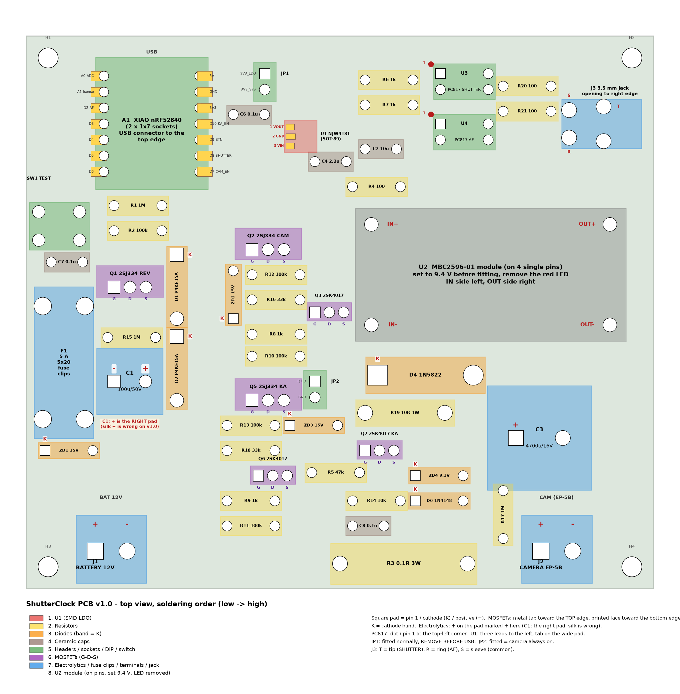
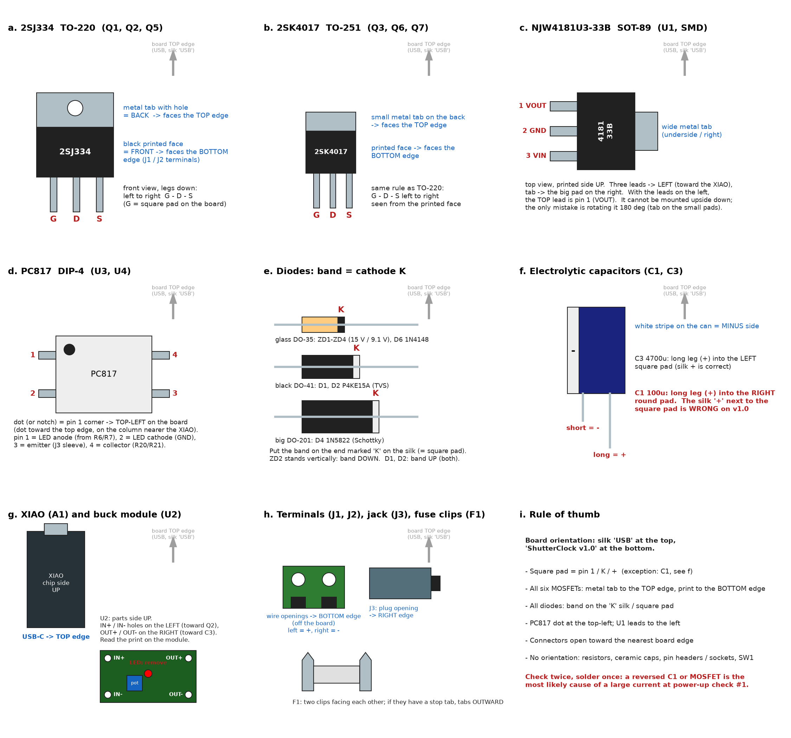

# 02. 組み立て（PCB v1.0）

対象: JLCPCB 製 ShutterClock PCB v1.0（100 × 88 mm、2 層）に [01_parts.md](01_parts.md) の部品を実装し、XIAO を挿す前の通電チェックまで。
基板の電気的なつながりの正は [pcb/README.md](../pcb/README.md)、回路の根拠は [設計仕様書](../ShutterClock_設計仕様書_v0.14.md) §6 です。

> **v1.0 の既知の問題（先に読む）**
> 1. **C1（100 µF/50 V）の「+」シルクが逆**です。基板には左側（四角いパッド）に「+」が印刷されていますが、そこは GND です。**C1 の + 足は右側（丸いパッド、Q1 側）** に入れてください（配置図参照）。v1.1 で直します。
> 2. **U2（MBC2596-01）の 4 つの穴位置は実物未確認**です。ピンをはんだ付けする前に、裸基板にモジュールを当てて穴が合うか確かめます（§4 の手順 5）。
> 3. 基板全体のレイアウトレビューはまだなので、通電チェック（§5）を省かないでください。

## 1. 用意するもの

- 温調はんだごて（SOT-89 の U1 とスルーホールの両方。先端は細めが楽）、はんだ、フラックス、はんだ吸い取り線
- ニッパ、ピンセット、ルーペ
- テスター（DC 0.01 V 分解能、導通ブザー）
- 安定化電源 12 V、**電流制限を 0.1 A に設定できるもの**（カメラを動かす段階では 4 A 以上）
- 部品: [01_parts.md](01_parts.md) の (a) 回路部品 + (d) PCB 版で追加（端子台 TB111-2 ×2、ピンソケット 1×7 ×2、ピンソケット 1×4 ×1）+ ピンヘッダ 1×40（JP1/JP2 用に 2 ピン ×2、U2 用に 1 ピン ×4 を折る）+ ジャンパピン ×2

## 2. 配置図

基板は **「ShutterClock v1.0」の文字が下、シルク「USB」が上** になる向きで置きます（下の図と同じ向き）。以下「上辺」「下辺」「左」「右」はこの向きで言います。

- 図の色は §4 のはんだ付け順（1 → 8）。**四角いパッド = ピン 1 / カソード（K）/ 電解コンデンサの +**（C1 だけ例外、上記）。部品の**外観でどう向きを見るか**は §3 の最後の表と図 `assembly/orientation.png`。
- KiCad のレンダ画像（基板の見た目に近い）: [pcb/render_top.png](../pcb/render_top.png)。配置図は `docs/assembly/draw_placement.py`、向きの図は `docs/assembly/draw_orientation.py` で生成しています。

## 3. 部品の見分け方

### 抵抗（1/4 W カーボン、4 本帯の場合。秋月の袋のラベルで確認）

| 値 | 帯の色 | 記号 | 本数 |
|---|---|---|---|
| 100 Ω | 茶 黒 茶 金 | R4, R20, R21 | 3 |
| 1 kΩ | 茶 黒 赤 金 | R6, R7, R8, R9 | 4 |
| 10 kΩ | 茶 黒 橙 金 | R14 | 1 |
| 33 kΩ | 橙 橙 橙 金 | R16, R18 | 2 |
| 47 kΩ | 黄 紫 橙 金 | R5 | 1 |
| 100 kΩ | 茶 黒 黄 金 | R2, R10, R11, R12, R13 | 5 |
| 1 MΩ | 茶 黒 緑 金 | R1, R15, R17 | 3 |
| 10 Ω 1 W（太い） | 茶 黒 黒 金 | R19 | 1 |
| 0.1 Ω 3 W（一番太い、値は印字） | — | R3 | 1 |

### ダイオード（すべて帯 = カソード K。基板のシルク「K」に帯を合わせる）

| 記号 | 部品 | 外観 | K（帯）の向き |
|---|---|---|---|
| ZD1, ZD2, ZD3 | 15 V ツェナー GDZJ15C | 小さいガラス | ZD1: 左端（基板の縁側）。ZD2: **下端**（縦向き）。ZD3: 左端 |
| ZD4 | 9.1 V ツェナー BZX55C9V1 | 小さいガラス | 左端（四角パッド） |
| D6 | 1N4148 | 小さいガラス | 左端（四角パッド） |
| D1, D2 | TVS P4KE15A | 黒い DO-41 | どちらも **上端**（USB 側）。2 本が同じ向きで直列 |
| D4 | ショットキー 1N5822 | 太い DO-201 | 左端（四角パッド、C3 の反対側） |

ガラスダイオードは 3 種類（15 V ×3、9.1 V ×1、1N4148 ×1）が見た目で紛らわしいので、**袋から 1 種類ずつ出して付け、付け終わってから次の袋を開けます**。

### コンデンサ

| 記号 | 値 | 印字 | 極性 |
|---|---|---|---|
| C6, C7, C8 | 0.1 µF 積セラ | 104 | なし |
| C4 | 2.2 µF 積セラ（5 mm） | 225 | なし |
| C2 | 10 µF 積セラ（5 mm） | 106 | なし |
| C1 | 100 µF / 50 V ハイブリッド | — | **あり。長い足 = + を右側のパッドへ（シルクの + は無視）** |
| C3 | 4,700 µF / 16 V | — | **あり。長い足 = + を左側の四角パッドへ**（シルクの + と一致） |

### 向きのある部品 — 部品の外観で見分ける

下の図は、各部品を手に取ったときに**どこを見るか**（印字面、金属タブ、帯、ドット、足の長さ、差し込み口）と、それを基板のどちらに向けるかをまとめたものです。基板は §2 の向き（シルク「USB」が上）で置きます。

| 記号 | 部品 | 外観で見るところ | 基板上の向き |
|---|---|---|---|
| Q1, Q2, Q5 | 2SJ334（TO-220、大きい方） | 片面が**穴あきの金属板**（放熱タブ）、反対面が**黒い樹脂に「2SJ334」の印字** | **金属面を上辺（USB）側、印字面を下辺（端子台 J1/J2）側**。印字面を自分に向けて足を下にすると、左から **G – D – S**。基板のシルクは上側の長辺だけ細い帯（切れ目 2 本）で、そこが金属面の側 |
| Q3, Q6, Q7 | 2SK4017（TO-251、小さい方） | 裏に**短い金属タブ**、表に「2SK4017」の印字 | TO-220 と同じ。**金属面を上辺側、印字面を下辺側**、左から G – D – S |
| U1 | NJW4181U3-33B（SOT-89、米粒大） | 片側から**足 3 本**、反対側に**幅広の金属タブ**、上面に印字 | 印字面を上（見える向き）にして、**足 3 本を左（XIAO 側）、タブを右の大きいパッド**に乗せる。足は上から 1 = VOUT、2 = GND（タブとつながる真ん中）、3 = VIN。裏返しには置けないので、間違えようがあるのは 180° 回転だけ（タブが小さいパッド側に来たら逆） |
| U3, U4 | PC817（DIP-4） | 上面の角に**丸いくぼみ（ドット）**、または端の切り欠き = ピン 1 側 | **ドットを左上**（上辺側の端、XIAO 寄りの列）。ピン 1 のパッドは四角 |
| ZD1〜ZD4, D6 | ガラスダイオード | 片端の**色帯 = カソード K** | 帯を基板のシルク「K」側（四角パッド側）に。**ZD2 だけ縦向きで帯が下** |
| D1, D2 | P4KE15A（黒い DO-41） | 片端の**白（銀）帯 = K** | **2 本とも帯を上**（USB 側）。同じ向きで直列 |
| D4 | 1N5822（太い黒、DO-201） | 片端の**白帯 = K** | 帯を左（四角パッド、C3 の反対側） |
| C3 | 4,700 µF / 16 V（大きい缶） | **長い足 = +**。缶の側面の**白い帯の側 = −** | 長い足を**左の四角パッド**（シルク + と一致）、白帯を右 |
| C1 | 100 µF / 50 V | 同上 | **長い足を右の丸パッド、白帯（−）を左の四角パッド**。基板の「+」シルクは左に印刷されているが**これは v1.0 の誤り** |
| A1 | XIAO nRF52840 | **USB-C コネクタ**、部品（シールド缶）面 | 部品面を上、**USB-C を上辺（シルク「USB」）**に向けてソケットに挿す |
| U2 | MBC2596-01 | 基板の角 4 か所の端子の印字 **IN+ / IN− / OUT+ / OUT−**、青い多回転ポテンショ、赤 LED | 部品面を上、**IN 側を左（Q2 側）、OUT 側を右（C3 側）**: IN+ 左上、IN− 左下、OUT+ 右上、OUT− 右下。LED は外す |
| J1, J2 | 端子台 TB111-2 | 上面にネジ 2 本、側面に**線の差し込み口**2 つ | **差し込み口を基板の外（下辺）へ**。左 = +、右 = − |
| J3 | 3.5 mm ジャック MJ-8435 | 片側に**プラグの差し込み口** | **差し込み口を右辺の外へ** |
| F1 | ヒューズクリップ FUC-03A ×2 | 抜け止めの爪の有無 | 2 個を向かい合わせに。爪があるタイプなら、爪を**外側（上下の端）**に向ける |
| SW1 | タクトスイッチ 6 mm | 足の間隔が 6.5 × 4.5 mm | 入る向きにしか入らない |
| 向きなし | 抵抗、積セラ、ピンヘッダ、ピンソケット | — | — |

**2 回確認して 1 回はんだ付け**: 通電チェック #1 で電流が大きいときの原因は、ほぼ C1 の向きか MOSFET の前後です。

## 4. はんだ付けの順番（背の低いもの → 高いもの）

1. **U1（表面実装）**: 部品がない裸基板のうちにやるのが一番楽。右の大きいパッドに予備はんだ → ピンセットで U1 を置き、タブを温めて固定 → 左の 3 本の足を 1 本ずつ。終わったらルーペで足同士のブリッジを確認し、テスターの導通で **1–2 間、2–3 間が短絡していない** ことを見る。
2. **抵抗 25 本**（§3 の表）。R3（3 W）と R19（1 W）は発熱するので基板から 1〜2 mm 浮かせる。R17 だけ縦向き。
3. **ダイオード 8 本**: K の向きを §3 の表と図で確認してから。ZD2 は縦向き（K が下）。
4. **積セラ C2, C4, C6, C7, C8**（向きなし）。
5. **ヘッダ・ソケット類**: JP1、JP2（2 ピンヘッダ）、XIAO 用ピンソケット 1×7 ×2（1 ピンだけ仮止めして垂直を直してから残りを付ける。**XIAO はまだ挿さない**）、U3・U4（PC817、ドットを左上）、SW1。
   **U2 用の 4 本の単ピンソケット（1×4 を切る）は、先に裸の MBC2596-01 を基板に当てて 4 つの穴が合うことを確認してから**。合わなければ単ピンは使わず、モジュールの端子から短い線で基板の穴へ落とす。
6. **MOSFET**: Q3, Q6, Q7（TO-251）→ Q1, Q2, Q5（TO-220）。全部「タブを上辺側」。
7. **背の高い部品**: C1（**+ は右**）、C3（+ は左）、F1 クリップ ×2、J1・J2 端子台（差し込み口を外へ）、J3 ジャック（差し込み口を右辺へ）。
8. **U2 モジュール**（§4.1 で準備してから）: モジュール側にピンヘッダ 4 本を付け、基板の単ピンソケットに挿す。**IN+ が左上、IN− が左下、OUT+ が右上、OUT− が右下**（モジュールの印字で確認）。

はんだ付け後、裏面をルーペで見て隣のパッドとのブリッジ、はんだ不足を確認。余った足はニッパで切る。

### 4.1 U2（MBC2596-01）の準備

1. モジュール単体で: 安定化電源 12 V（電流制限 0.1 A）を IN+ / IN− につなぎ、テスターを OUT+ / OUT− に当てて、多回転ポテンショを回して **9.40 V** に合わせる（時計回りで上がるか下がるかはモジュールによる）。
2. 電源を外し、**赤 LED を外す**（LED の足をニッパで切るか、はんだを溶かして抜く）。LED は約 7 mA 食い続けるので外さないと撮影ごと給電の意味が薄れる。
3. 4 本の端子穴にピンヘッダを立ててはんだ付け。

## 5. 通電チェック（XIAO と U2 を挿す前に）

安定化電源を **12.0 V、電流制限 0.1 A** にして J1 に赤 → +（左）、黒 → −（右）。テスターの黒棒は J1 の −。JP1 は付けたまま、**JP2 は外す**。

| # | 測るところ | 期待値 | 意味 |
|---|---|---|---|
| 1 | 電源の電流表示 | **1 mA 未満**（本来は数十 µA） | 短絡・向き違いがない。大きければすぐ切る |
| 2 | C1 の右パッド（+）、または Q1 の右ピン（S） | **12.0 V 前後**（電源電圧 − 0.1 V 以内） | ヒューズ F1 → 逆接保護 Q1 を通った VIN |
| 3 | JP1 の上ピン（3V3_LDO） | **3.27〜3.33 V** | U1 の出力 |
| 4 | XIAO ソケットの **3V3** 位置（右列、上から 3 番目） | 同上 | JP1 を通って XIAO へ |
| 5 | XIAO ソケットの **A0** 位置（左列、一番上） | **VIN ÷ 11 ≈ 1.09 V** | 電池分圧 R1/R2 |
| 6 | J2 の +（CAM+）、U2 の IN+ 穴 | **0 V** | カメラ系は OFF |
| 7 | **JP2 にジャンパピンを挿す** → U2 の IN+ 穴 | **12 V 前後** | Q2 が ON（JP2 = 常時 ON）。外すと 0 V に戻る（少し時間がかかる） |
| 8 | ジャンパ線で XIAO ソケットの **D7** 位置（右列、一番下）を 3V3（JP1 の上ピン）に触れさせながら U2 の IN+ 穴 | **12 V 前後**、離すと 0 V | CAM_EN → Q3 → Q2 |
| 9 | 同じく **D10** 位置（右列、上から 4 番目）を 3V3 に触れさせながら J2 の + | **7〜8.5 V**（しばらく保持。R17 でゆっくり下がる） | 時計保持経路 Q6 → Q5 → R19 → Q7 フォロワ。**値をメモ**（ZD4 の最終決定に使う。目標 8〜9 V） |
| 10 | 同じく **D8** 位置（右列、下から 2 番目）を 3V3 に触れさせながら、J3 の T（チップ）と S（スリーブ）の間をテスターの抵抗レンジで | **数十〜数百 Ω**（離すと ∞） | SHUTTER のフォトカプラ U3 と R20。**D2**（左列、上から 3 番目）で R（リング）–S 間が同様なら AF 側（U4、R21）も OK |
| 11 | （任意）電源の赤黒を J1 で逆につなぐ | 電流 0、#2 の点が 0 V | 逆接保護。すぐ戻す |

すべて合格したら電源を切り、**U2 を挿して** JP2 を付け、再び 12 V を入れる:

| # | 測るところ | 期待値 | 意味 |
|---|---|---|---|
| 12 | 電源の電流表示 | **10〜20 mA** | LM2596 の無負荷電流（LED を外してあれば） |
| 13 | U2 の OUT+ 穴 | **9.4 V** | モジュールの調整値 |
| 14 | J2 の +（CAM+） | **9.1〜9.3 V** | D4（ショットキー）を通った後。無負荷では 0.1〜0.3 V 落ちる |

終わったら JP2 を外し、電源を切ります。

## 6. XIAO を挿してから

- **規則（シルク「REMOVE JP1 BEFORE USB」）**: 電池や安定化電源を J1 につないだまま USB を XIAO に挿すときは、**先に JP1 を抜く**。JP1 を抜けば XIAO は USB から給電され、基板側（U1 の 3.3 V）と切り離される。USB を抜いたら JP1 を戻す。
- 書き込みは XIAO 単体で USB からでもよい（[firmware/README.md](../firmware/README.md)、SnowGauge の 03_firmware.md と同じ手順）。
- 挿したら [firmware/README.md](../firmware/README.md) の「First bench session」の順にシェルで確認: `cam status` → `batt`（テスターの VIN と比べ、ズレを `CONFIG_SHUTTERCLOCK_VBAT_GAIN_PERMILLE` で補正）→ `cur`（カメラなしで 0 mA 付近）→ `cam on` → `release` → `shoot` → `ka on`。
- カメラをつなぐ前に安定化電源の電流制限を **4 A 以上** にする（2 A 制限では D7500 が Err になる）。
- **EP-5B のケーブル**: 先端のプラグ（EH-5b 用）を切り、2 本の線を J2 に **+ 左 / − 右** で締める。どちらが + かは、EP-5B のダミーバッテリーの端子（+ / − の刻印）と線の間の導通で確かめる。J2 の − はカメラ電流の検出用シャント（R3）なので、カメラの GND を他の経路（三脚やホットシューなど）で基板 GND に落とさない。
- **レリーズケーブル**: 3.5 mm プラグのチップ / リング / スリーブがどの機能かはケーブルごとに違う。カメラにケーブルを挿した状態で、プラグのスリーブとリングをピンセットで短絡 → 半押し（測光が動く）、スリーブとチップ + リングを短絡 → シャッター、となる組み合わせを確かめてから J3 に挿す（基板側は T = SHUTTER、R = AF、S = 共通）。合わなければケーブル側で入れ替えるか、`pcb/README.md` に記録して v1.1 で直す。

## 7. 通電チェックで値が合わないとき

| 症状 | 疑う場所 |
|---|---|
| #1 で電流が大きい | C1 の向き（+ は右）、D1/D2 の向き（K は上）、Q1 の向き、裏面のブリッジ |
| #2 で VIN が出ない / 0.6 V 以上低い | F1 がクリップに入っているか、Q1 の向き（タブが上辺、G-D-S）、R15 の有無（G を GND に引かないと Q1 が ON にならない） |
| #3 で 3.3 V が出ない / 低い | U1 の向きと足のはんだ（1 = VOUT が上）、R4・C2 のはんだ、U1 の 3 番ピンに VIN − 数 mV が来ているか |
| #7 / #8 で 12 V が出ない | Q2 の向き、R16 の有無（Q3 → Q2 ゲート）、Q3 の向き（G-D-S）、R8/R10 の値 |
| #8 で離しても 12 V のまま | Q3 の G-S 短絡、R10（100 kΩ プルダウン）の有無、JP2 が刺さったまま |
| #9 で電圧が出ない | Q5/Q6 の向き、R18、R19、Q7 の向き（S が右 = CAM+）、R5、ZD4/D6 の向き（K が左） |
| #9 で 9 V を超える | ZD4 が 9.1 V でない、または D6 の向き |
| #10 で導通しない | PC817 の向き（ドットが左上）、R6/R7、R20/R21 |
| #14 で 9 V が出ない | U2 の IN/OUT の向き、D4 の向き（K は左 = C3 側） |
